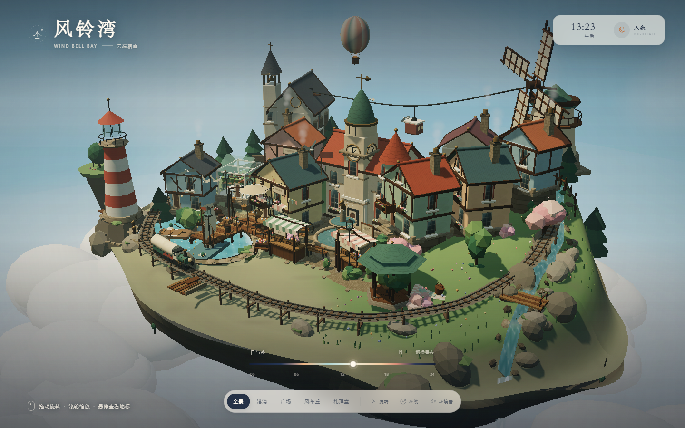
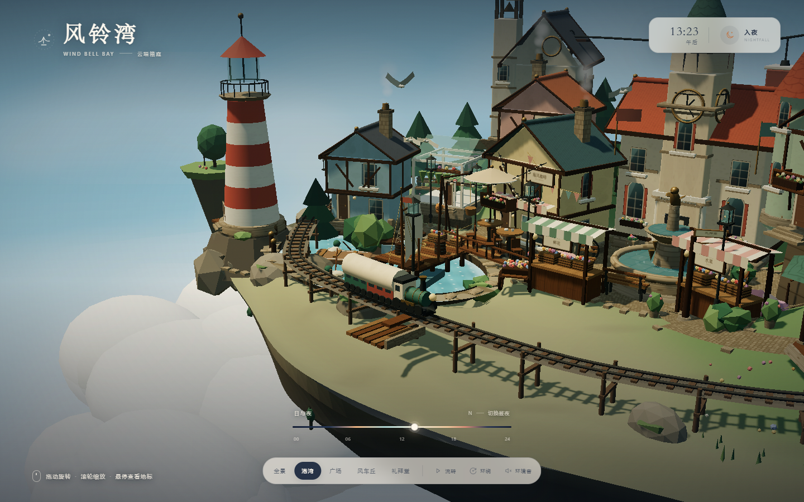
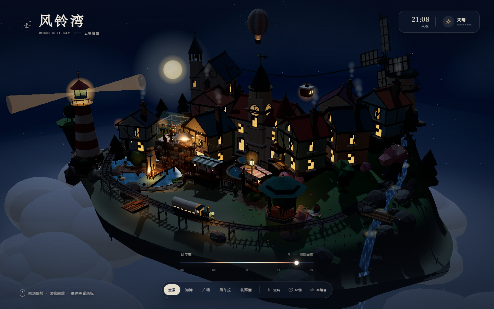
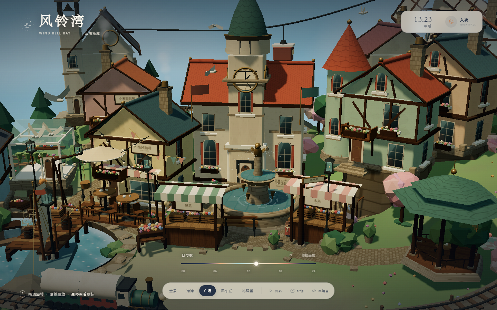
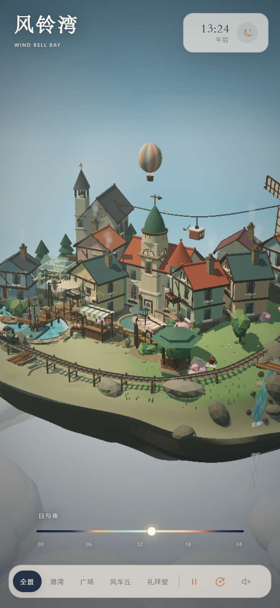

# 风铃湾 · Wind Bell Bay

一座漂在云上的 3D 箱庭小镇。所有地形、建筑、灯光、贴图与音效均由代码实时生成，**单文件、完全离线、无需安装任何依赖**。

> **在线访问 / Live demo**：<https://eric-thy.github.io/windbell-bay/>



## 打开方式

双击 **`index.html`** 即可。

- 推荐浏览器：Chrome / Edge / Safari 新版（需要 WebGL2）。
- 不需要开本地服务器，也不需要联网。
- 页面中的图形、字体 fallback、音频全部在本地运行。

## 操作

| 操作 | 说明 |
| --- | --- |
| 拖动 / 单指拖动 | 环绕旋转视角 |
| 滚轮 / 双指缩放 | 拉近、拉远 |
| 悬停地标 | 显示地标名称，点击可前往对应机位 |
| 右上角月亮/太阳 | 平滑切换昼夜；切换后时间暂停 |
| 底部时间轴 | 任意拖动到一天中的时刻 |
| `流转` | 开启 / 暂停自动昼夜流转 |
| `环绕` | 开启 / 暂停自动环绕镜头 |
| `环境音` | 开启实时合成的风声、潮声与风铃 |
| `全景 / 港湾 / 广场 / 风车丘 / 礼拜堂` | 五个预设机位 |
| 键盘 `N` | 切换昼 / 夜 |
| 键盘 `Space` | 暂停 / 继续时间 |
| 键盘 `O` | 开启 / 暂停环绕 |
| 键盘 `R` | 回到全景 |
| 键盘 `1`–`5` | 切换五个机位 |

## 场景里有什么

- **五层高低台地**：港口、主广场、山坡住宅、礼拜堂高地、风车丘；圆润的地形、石砌护坡、坡屋顶和塔楼避免“方块堆砌”。
- **会走动的世界**：环岛小火车、起伏缆车、热气球、帆船与渔船、摇橹小船、海鸥、鸭子、三只绵羊、散步居民、转动的风车与风铃。
- **手工细节**：钟楼实时钟面、面包房与咖啡馆招牌、条纹雨棚、花箱、集市蔬果、晾衣绳、自行车、猫咪、灯塔光束、码头吊车、野餐篮、信箱、告示板。
- **昼夜与天气气氛**：太阳/月亮、星空、月光、窗灯、街灯、萤火虫、灯串、蒸汽、动态水面、云海和流瀑；夜间的钟楼广场有暖黄灯光。
- **实时交互**：拖拽、缩放、地标悬停/点击、机位平滑过渡、移动端自适应构图。

### 预览

| 港湾 | 夜晚 |
| --- | --- |
|  |  |

| 广场 | 手机 |
| --- | --- |
|  |  |

## 文件

```
windbell-bay/
├── index.html          # 交付主文件：自包含，双击即开
├── README.md
├── THIRD_PARTY_NOTICES.txt
├── preview-day.png
├── preview-night.png
├── preview-harbor.png
├── preview-square.png
└── preview-mobile.png
```

## 实现说明

- Three.js r164 + OrbitControls + UnrealBloom，通过 esbuild 内联打包进单个 HTML。
- 地形、岛屿底部、屋顶瓦片、石墙、窗格、招牌、雨棚、水面、瀑布等均为程序化几何或 Canvas 生成的纹理。
- 昼夜使用太阳高度角驱动的统一状态：天空渐变、雾色、云色、平行光、半球光、窗灯、路灯、月光、星星、水面颜色全部联动。
- 音频通过 Web Audio API 实时合成，未加载任何外部音源。
- 工程追求的是“可旋转的桌面微缩模型”质感：低多边形轮廓、细腻的纹理/标记、柔和的色调和明显的顶部天光反射。

## 第三方

- Three.js (r164) — MIT License，见 `THIRD_PARTY_NOTICES.txt`。
